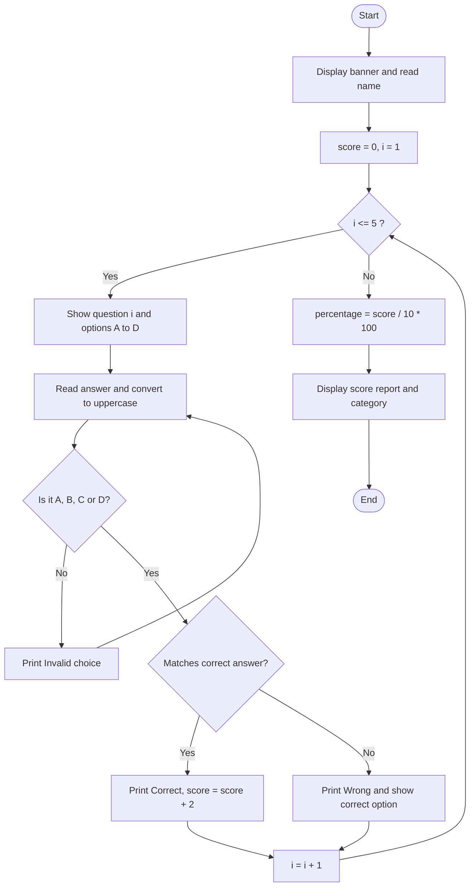

# Quiz and Score Management System

**Mini Hackathon | C Programming | Problem 10**

## Team Details

| Field | Details |
|---|---|
| Team Number | _(fill in)_ |
| Batch | _(fill in)_ |
| Faculty | Dr. Vinod Kumar |

| Member | SAP ID |
|---|---|
| Niharika Shaily | 590039661 |
| Kaushik Dubey | 590038162 |
| Bhumit Juneja | 590039787 |

## Problem Statement

Build a command-line quiz application in C that presents multiple-choice questions to a participant, checks each answer, calculates the total score and percentage, and displays a performance category at the end.

## Objectives

- Present multiple-choice questions one at a time with four options (A to D).
- Accept only valid answers and ask again on invalid input.
- Give instant feedback and reveal the correct option when the answer is wrong.
- Calculate marks, percentage and a performance category automatically.

## Features

- 5 questions with 4 options each, stored using a `struct` and an array.
- 2 marks per correct answer, no negative marking (total 10 marks).
- Case-insensitive answers (`a` and `A` are both accepted).
- Input validation: invalid answers are rejected, and extra characters typed after the first letter are ignored, so no question is skipped.
- Participant name may contain spaces (for example, "Niharika Shaily").
- Safe handling of unexpected end of input.
- Score report with marks, percentage and category:

| Percentage | Performance |
|---|---|
| 80 and above | Excellent |
| 60 to 79 | Good |
| 40 to 59 | Average |
| Below 40 | Needs Improvement |

## Algorithm

1. Start. Display the title banner.
2. Read the participant's name (full line, spaces allowed).
3. Set `score = 0`.
4. For each question `i` from 1 to 5:
   1. Display the question and options A to D.
   2. Read one character as the answer and discard the rest of the line.
   3. Convert it to uppercase. If it is not A, B, C or D, show "Invalid choice" and go back to step 4.2.
   4. If it matches the correct answer, print "Correct answer!" and add 2 to `score`. Otherwise print the correct option.
5. Calculate `percentage = score / 10 * 100`.
6. Display the score report and the performance category.
7. Stop.

## Flowchart



## C Concepts Used

- `struct` to store a question, its options and the correct answer
- Arrays: array of structures and a 2D `char` array for options
- Strings and character handling
- Functions: `clearBuffer()`, `showQuestion()`, `getAnswer()`, `showReport()`
- Loops: `for` (questions) and `while` (input validation)
- Conditional statements: `if`, `else if`, `else`
- Relational and logical operators
- Preprocessor `#define` constants
- Type casting for the percentage calculation
- Library functions: `printf()`, `scanf()`, `getchar()`, `toupper()`

## How to Compile and Run

Requires a C compiler such as GCC.

```bash
gcc quiz_score_management.c -o quiz
./quiz
```

On Windows (MinGW):

```bash
gcc quiz_score_management.c -o quiz.exe
quiz.exe
```

## Sample Test Cases

| # | Input | Expected result | Actual result |
|---|---|---|---|
| 1 | All five answers correct (C, A, D, B, C) | 10 marks, 100.00%, Excellent | 10 marks, 100.00%, Excellent |
| 2 | Four correct, one wrong | 8 marks, 80.00%, Excellent | 8 marks, 80.00%, Excellent |
| 3 | All five answers wrong | 0 marks, 0.00%, Needs Improvement | 0 marks, 0.00%, Needs Improvement |
| 4 | Invalid answer such as `x` | "Invalid choice! Try again." and question repeats | Same as expected |
| 5 | Lowercase answer such as `c` | Accepted as `C` | Accepted as `C` |
| 6 | Extra characters such as `ab` | Only `A` is used, next question is not skipped | Same as expected |
| 7 | Name with a space | Full name shown in report | Full name shown in report |
| 8 | Input ends early (Ctrl+D) | Quiz stops and report is shown | Same as expected |

## Sample Output

Input used: name `Niharika Shaily`, answers `c`, `A`, `xyz`, `d`, `ab`, `C`.

```text
================================
   QUIZ AND SCORE MANAGEMENT
================================
Enter your name: Niharika Shaily

Welcome, Niharika Shaily!
Each correct answer carries 2 marks.
There is no negative marking.

Question 1: C is which type of language?
A. Markup language
B. Query language
C. Procedural programming language
D. Scripting-only language
Enter your answer (A/B/C/D): c
Correct answer!

Question 2: Who is known as the father of C language?
A. Dennis Ritchie
B. James Gosling
C. Bjarne Stroustrup
D. Charles Babbage
Enter your answer (A/B/C/D): A
Correct answer!

Question 3: Which symbol ends a C statement?
A. .
B. :
C. ,
D. ;
Enter your answer (A/B/C/D): xyz
Invalid choice! Try again.
Enter your answer (A/B/C/D): d
Correct answer!

Question 4: Which function is used to display output in C?
A. scanf()
B. printf()
C. main()
D. getchar()
Enter your answer (A/B/C/D): ab
Wrong answer! Correct answer is B.

Question 5: Which data type stores whole numbers?
A. float
B. char
C. int
D. double
Enter your answer (A/B/C/D): C
Correct answer!

================================
          SCORE REPORT
================================
Participant: Niharika Shaily
Total Marks: 10
Obtained Marks: 8
Percentage: 80.00%
Performance: Excellent
================================
       THANK YOU FOR PLAYING!
================================
```

## Project Structure

```text
Quiz_Score_Management/
├── README.md
├── quiz_score_management.c
├── presentation.pptx
├── flowchart.png
└── screenshots/
    └── sample_output.png
```

## Future Scope

- Load questions from a file instead of hard-coding them.
- Randomise question order.
- Add a timer and a high-score table.
- Add optional negative marking.
